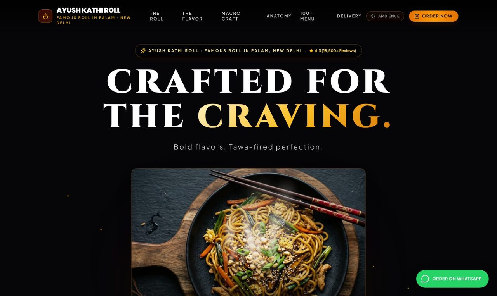
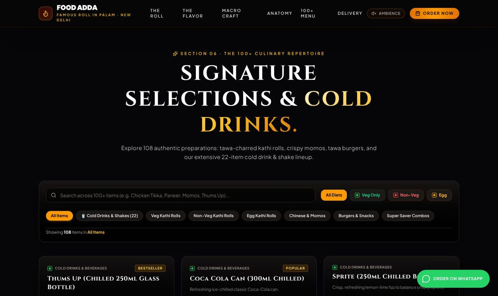
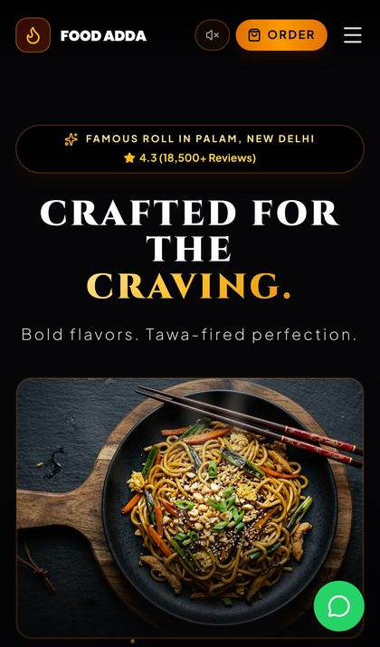

<div align="center">

# 🌯 Ayush Kathi Roll

**Famous Roll in Palam, New Delhi.** Tawa-fresh kathi rolls, momos, burgers and cold drinks.
Home delivery only, ordered straight through WhatsApp.

[**🌐 Live website**](https://ayush-kathi-roll.vercel.app) · [**💬 Order on WhatsApp**](https://wa.me/918595374660)



</div>

## ✨ Highlights

- **Cinematic food visuals:** slow camera motion, live steam and a sizzling paneer pan, all built on real food photos.
- **Full menu:** 100+ dishes and 22 cold drinks and shakes, with search and veg / non-veg / egg filters.
- **WhatsApp ordering:** customers add dishes, set quantities and an address, and send a ready-made order message to the shop.
- **Fast on every device:** compressed WebP images sized per screen, lighter effects on phones, lazy loading and long-term caching.
- **Ready for Google:** search title and description, share image, favicon and Restaurant business data.

<p align="center">
  
  &nbsp;
  
</p>

## 🛠 Built with

React 19 · Vite · Tailwind CSS 4 · TypeScript · hosted on Vercel

## 🚀 Run locally

Requires Node.js 20+.

```bash
npm install --legacy-peer-deps
npm run dev        # http://localhost:3000
npm run build      # production build in dist/
```

## ⚙️ Shop settings

| What | Where |
| --- | --- |
| Shop name, address, WhatsApp number, timings | `OUTLET_INFO` in `src/data/menu.ts` |
| Menu items and prices | `src/data/menu.ts` |
| Food photos | `src/assets/images/web` |
| Google title, description and business info | `index.html` |

## 🌍 Deploy

Every push to `main` deploys automatically on Vercel. To deploy a copy elsewhere, import the repository in Vercel (settings are in `vercel.json`) or run `npx vercel --prod`.

## 📞 Contact

WhatsApp / phone: **+91 85953 74660**
